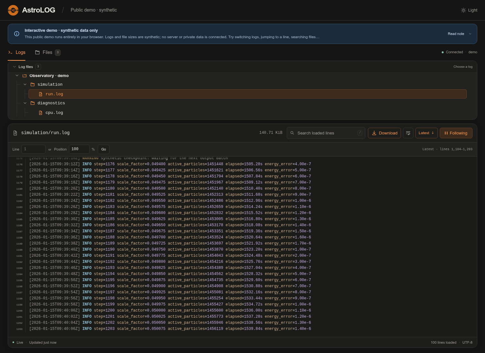

# AstroLOG

[English](#english) · [中文](#中文) · [Live demo](https://dingdingluan.github.io/AstroLOG/)



## English

View and follow server logs in your browser. Scroll back through history, jump to a line or position, search filenames, and download logs. Includes a folder explorer, Markdown notes, light/dark themes, and a mobile layout.

The online demo uses sample data generated in your browser. To view your own logs, install the server below.

### Quick start

Requires Python 3.10+ with `venv`, Bash, and Git. No root access needed.

```bash
git clone https://github.com/DingdingLuan/AstroLOG.git
cd AstroLOG
bash scripts/install.sh
cp config/demo.yaml config/config.yaml
bash scripts/start_demo.sh
bash scripts/start.sh
```

Open **http://127.0.0.1:8765/**. The sample producer updates three logs every 3 seconds.

```bash
bash scripts/stop.sh          # stop the viewer
bash scripts/stop_demo.sh     # stop the sample producer
```

### Your own logs

Copy `config/example.yaml` to `config/config.yaml`, set a source `root`, and list the logs to expose:

```yaml
display:
  title: AstroLOG
  server_name: my-server
  default_file: work.main
data:
  sources:
    work:
      type: local
      root: /path/to/project
      files:
        main: output/run.log
      inventory:
        patterns: ["snapshot_*"]
```

Restart after changing YAML. Relative source and announcement paths resolve from the YAML file's directory; log paths resolve from their source root. Only registered logs can be viewed/downloaded. Filename search covers all configured roots and subdirectories, regardless of inventory patterns.

The viewer never changes source files. For remote logs, use the optional SSH collector below or sync them to a local directory yourself.

### Share access

Set the listening address and port in `config/config.yaml`. The defaults are `127.0.0.1:8765`; for example, to use port 9000:

```yaml
server:
  host: 127.0.0.1
  port: 9000
```

Restart the viewer after editing:

```bash
bash scripts/stop.sh
bash scripts/start.sh
```

Open **http://127.0.0.1:9000/**. To allow LAN access, change `host` to `0.0.0.0`, which listens on all local IPv4 interfaces. Visitors use the machine's actual IP address or domain and the chosen port, such as `http://192.168.1.20:9000/`; `0.0.0.0` is a listening address, not the browser address.

Explicit CLI options `--host` / `--port` override `LOGPRESENT_HOST` / `LOGPRESENT_PORT`, which override YAML, then defaults. `LOGPRESENT_CONFIG` selects another configuration file when using the launcher.

For passphrase access, run `.venv/bin/python scripts/set_token.py`, then set `security.enabled: true` and `security.token_file: ../var/auth/access-token`. Sessions use an HttpOnly cookie. Set `security.secure_cookie: true` when serving over HTTPS.

`deploy/` contains optional Nginx and user-systemd examples. For SSE, keep proxy buffering disabled. The detached launcher writes `var/log/server.log`; it does not start automatically after reboot.

Edit `content/announcement.md` to update the optional note without restarting. See the annotated YAML examples for display, refresh and file-list settings.

### Remote logs

Copy `config/collector.example.yaml` to `config/collector.yaml`. You can put the connection details directly in YAML:

```yaml
ssh:
  host: 203.0.113.10
  user: my-user
  port: 2222
  identity_file: ~/.ssh/id_ed25519_my_server
remote_root: /path/to/project
local_root: ../var/replicas/my-server
poll_seconds: 1
inventory_seconds: 30
logs:
  output/info.txt: output/info.txt
```

The collector uses AsyncSSH inside Python; no system `ssh` executable is needed. The remote Unix/Linux machine needs its existing SSH service and Python 3; it does not need AsyncSSH installed.

`identity_file` points to the private key on the collector machine. Optional `certificate_file` and `known_hosts` fields select an OpenSSH certificate and a trusted host-key file. Without `known_hosts`, the collector checks the user's usual `~/.ssh/known_hosts`. Relative file and cache paths resolve from the collector YAML directory.

You can also replace the `ssh` block with `ssh_hops: [my-server]`, using SSH aliases supported by AsyncSSH. With `[relay, my-server]`, AsyncSSH forwards the second connection through the first. **Both aliases, their settings, and all required keys are read on the collector machine.** Older profiles which relied on a key stored only on the relay need updating. Choose either `ssh` or `ssh_hops`.

To run the collector directly in your Python environment:

```bash
python -m logpresent.collector --config config/collector.yaml
```

The Bash helpers are optional:

```bash
bash scripts/start_collector.sh
bash scripts/stop_collector.sh  # stop collection; the viewer stays running
```

Point a viewer source at the cache directory, list its log files, and set `inventory.manifest` to the cache's `inventory.json`. The collector can run on another local machine: if the machines share an NFS directory, write the cache there and have the viewer read the same directory through its own mount path. No SSH connection between those two local machines is needed. `collector-status.json` records connection state and the last update.

The remote reader remembers its byte offset and sends appended bytes over a persistent SSH connection. The collector handles keepalives, timeout detection, reconnection, and resuming from the saved position; replaced or truncated logs start a new copy. Snapshot and restart contents stay remote; only names, sizes, and modification times are collected for the configured paths.

### Development

```bash
.venv/bin/python -m pip install -r requirements-dev.txt
.venv/bin/python -m unittest discover -s tests -q
```

[MIT license](LICENSE) · [Astroslacker](https://astroslacker.com/)

---

## 中文

把服务器上的日志放到网页里看。新内容会自动追加，也能向上翻旧记录、跳到指定行、搜索文件名和下载日志。支持浅色、深色主题，手机上也能用。

在线演示用的是浏览器里生成的示例数据。想看自己的日志，按下面的步骤安装即可。

### 安装

需要 Python 3.10+（含 `venv`）、Bash 和 Git，不需要 root 权限。

```bash
git clone https://github.com/DingdingLuan/AstroLOG.git
cd AstroLOG
bash scripts/install.sh
cp config/demo.yaml config/config.yaml
bash scripts/start_demo.sh
bash scripts/start.sh
```

打开 **http://127.0.0.1:8765/**。示例会生成三个日志，每 3 秒更新一次。

停止服务：

```bash
bash scripts/stop.sh       # 停止网页服务
bash scripts/stop_demo.sh  # 停止生成示例日志
```

### 换成自己的日志

复制 `config/example.yaml` 为 `config/config.yaml`，修改目录和文件路径。例如：

```yaml
display:
  title: AstroLOG
  server_name: my-server
  default_file: work.main
data:
  sources:
    work:
      type: local
      root: /path/to/project
      files:
        main: output/run.log
      inventory:
        patterns: ["snapshot_*"]
```

这个配置会打开 `/path/to/project/output/run.log`，在连接状态旁显示 `my-server`，并在文件列表里显示匹配 `snapshot_*` 的文件。

改完 YAML 后重启服务。只有 `files` 里列出的日志能打开和下载；文件名搜索会查找所有已配置目录及其子目录，不受 `inventory.patterns` 限制。

如果使用相对路径，`root` 和公告路径从配置文件所在目录算起，日志路径则从 `root` 算起。编辑 `content/announcement.md` 就能更新页面公告，不用重启。

AstroLOG 不会修改日志文件。远程日志可以使用下面的 SSH 采集器，也可以自行同步到本地。

### 让其他人访问

监听地址和端口写在 `config/config.yaml` 里，默认是 `127.0.0.1:8765`。比如想换成 9000 端口：

```yaml
server:
  host: 127.0.0.1
  port: 9000
```

改完后重启：

```bash
bash scripts/stop.sh
bash scripts/start.sh
```

然后打开 **http://127.0.0.1:9000/**。如果要让局域网里的其他人访问，把 `host` 改成 `0.0.0.0`，表示监听本机所有 IPv4 网络接口。访问时填机器的实际 IP 或域名，加上端口，例如 `http://192.168.1.20:9000/`；不要在浏览器里填 `0.0.0.0`。

如果同时设置了多处，优先级是：命令行 `--host` / `--port` > 环境变量 `LOGPRESENT_HOST` / `LOGPRESENT_PORT` > YAML > 默认值。启动脚本还可以通过 `LOGPRESENT_CONFIG` 指定另一份配置文件。

服务在后台运行，运行日志保存在 `var/log/server.log`；重启机器后需要重新启动服务。

需要登录口令时，先运行 `.venv/bin/python scripts/set_token.py`，再在 YAML 中设置 `security.enabled: true` 和 `security.token_file: ../var/auth/access-token`。浏览器通过 Cookie 保持登录；使用 HTTPS 时再设置 `security.secure_cookie: true`。

`deploy/` 里有 Nginx 和 systemd 配置示例。用 Nginx 反向代理时，需要关闭缓冲，让日志能及时推送到浏览器。

### 远程日志

复制 `config/collector.example.yaml` 为 `config/collector.yaml`。连接参数可以直接写在 YAML 里：

```yaml
ssh:
  host: 203.0.113.10
  user: my-user
  port: 2222
  identity_file: ~/.ssh/id_ed25519_my_server
remote_root: /path/to/project
local_root: ../var/replicas/my-server
poll_seconds: 1
inventory_seconds: 30
logs:
  output/info.txt: output/info.txt
```

采集器现在直接使用 Python 的 AsyncSSH 库，不再调用系统的 `ssh` 命令。远端 Unix/Linux 机器只需要已有的 SSH 服务和 Python 3，不用安装 AsyncSSH。

`identity_file` 是采集机器上的私钥路径。还可以用 `certificate_file` 指定 OpenSSH 证书，用 `known_hosts` 指定可信主机密钥文件。不填 `known_hosts` 时，默认检查用户的 `~/.ssh/known_hosts`。这些文件和缓存的相对路径都从采集 YAML 所在目录算起。

也可以把 `ssh` 这一段换成 `ssh_hops: [my-server]`，使用 AsyncSSH 支持的 SSH 别名配置。填 `[relay, my-server]` 时，AsyncSSH 会通过第一条连接转发第二条连接。**两个别名的配置和需要的密钥都从采集机器读取。** 旧配置如果依赖只放在 relay 上的密钥，需要相应调整。`ssh` 和 `ssh_hops` 二选一。

在 Python 环境里可以直接启动：

```bash
python -m logpresent.collector --config config/collector.yaml
```

Bash 后台脚本也可以继续用：

```bash
bash scripts/start_collector.sh
bash scripts/stop_collector.sh  # 停止采集，网页服务继续运行
```

网页的数据源指向缓存目录，在 `files` 中列出日志，并将 `inventory.manifest` 指向缓存里的 `inventory.json`。采集器也可以放在另一台本地机器上：两台机器有 NFS 共享目录时，采集器写入共享目录，网页通过自己的挂载路径读取同一份文件，两者之间就不需要再加 SSH。`collector-status.json` 记录连接状态和最后更新时间。

远端读取程序记住已经读到的字节位置，通过 SSH 长连接发送新增部分。采集器负责心跳、超时检测、重连和断点续传；文件被替换或清空时重新同步。快照和 restart 内容留在远程，只读取已配置路径下的名称、大小和修改时间。

### 开发

修改代码后，可以这样运行测试：

```bash
.venv/bin/python -m pip install -r requirements-dev.txt
.venv/bin/python -m unittest discover -s tests -q
```

[MIT 许可证](LICENSE) · [Astroslacker](https://astroslacker.com/)
